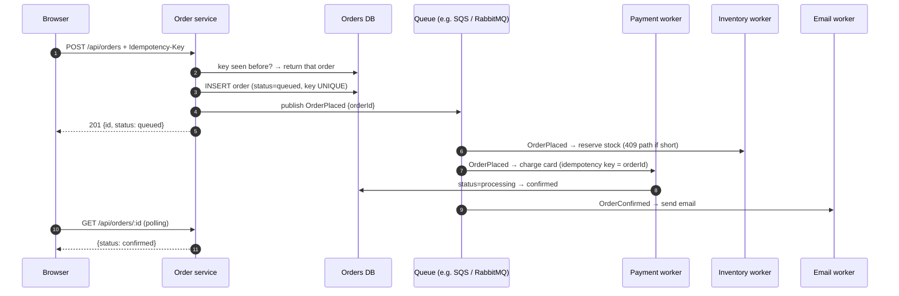
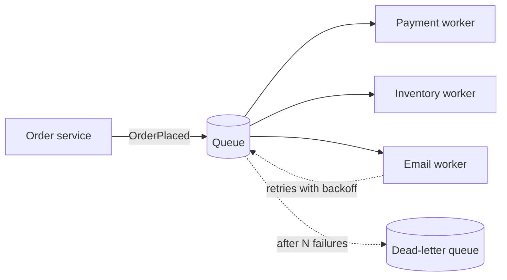

# Order flow: queues and services

How placing an order would work with a real backend. The mock API already behaves like this from the outside:
`POST /api/orders` answers **201 `{ status: "queued" }`** right away, and `GET /api/orders/:id` later reports
`processing` and then `confirmed`, which the confirmation page polls for.

## Diagram

## Why a queue helps

- **Fast, reliable response:** the order service only saves the order and publishes one message, so the shopper gets a 201 in
  milliseconds instead of waiting for the card processor, the stock check and the email server one after another.
- **Failures are isolated:** each worker fails and retries on its own. A slow email provider can't slow down or fail checkout.
- **Absorbs spikes:** a sale that brings 10× traffic fills the queue instead of crashing the payment provider.
  Workers drain it at their own pace and can be scaled out horizontally.
- **Retries for free:** if a worker crashes, the message is not acknowledged and is delivered again.

## What happens if email is down

Nothing the shopper notices. The order is already saved, paid and confirmed. The email worker's sends fail, so its
messages are retried with exponential backoff. After N attempts they go to a **dead-letter queue**, which alerts on-call and can be
replayed once the provider recovers. The confirmation page already shows the order status, so the shopper isn't left waiting for the email.
The email is _eventually_ sent (see "eventual consistency" in [glossary.md](glossary.md)).

## How double charges are prevented (my D3-2 approach)

Three layers: client, server, and the workers behind the queue.

1. **Client:** each checkout attempt has one `Idempotency-Key` (a UUID stored in `sessionStorage`, tied to the cart contents).
   A double click, a retry after a 500 or timeout, or even a page reload sends **the same key**. A ref also blocks a
   second submit before React re-renders. Changing the cart makes a new key, because that really is a different order.
2. **Server:** the order service stores the key with a `UNIQUE` constraint. A repeat key returns the **original** order and
   publishes nothing new (`src/mocks/handlers.ts` does exactly this; tests prove one order is created).
3. **Downstream:** messages can be delivered more than once (at-least-once delivery), so the payment worker passes
   `orderId` as the payment provider's idempotency key, and the inventory worker records which orders it has applied.
   A message delivered twice still results in one charge and one stock reservation.
